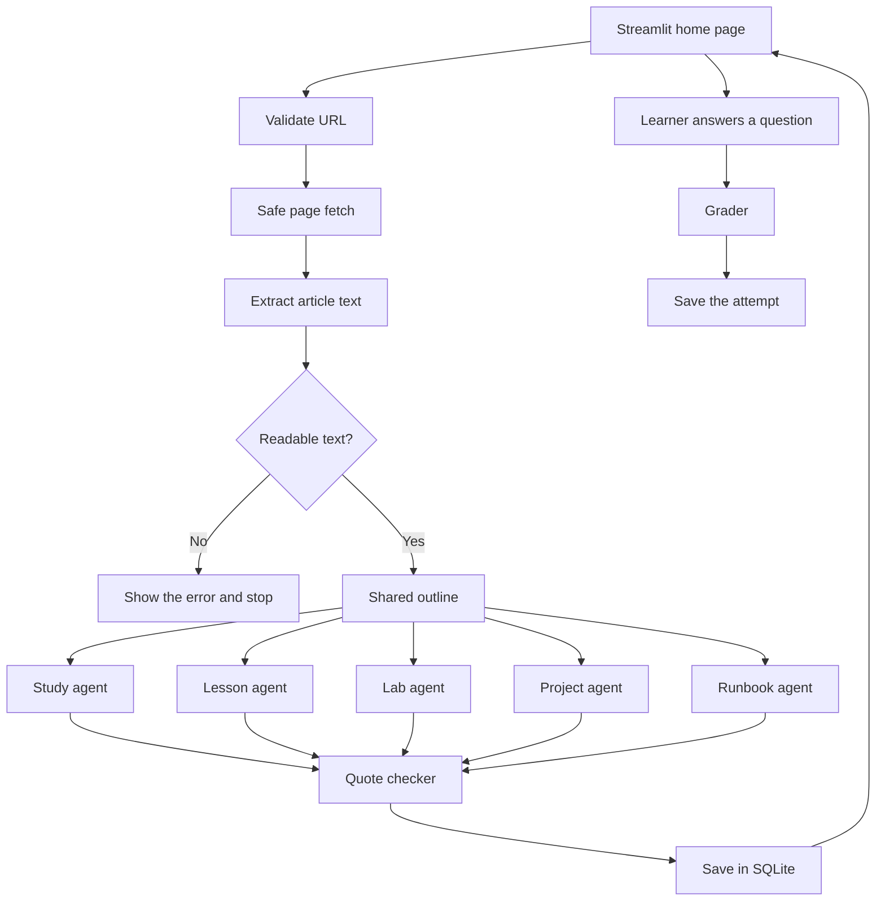

# StudyMaster AI agent plan

The end-to-end agent diagram picture is [end-to-end-agentic-diagram.png](end-to-end-agentic-diagram.png). The learner-step picture is [end-to-end-diagram.png](end-to-end-diagram.png). The written copy is [end-to-end-diagram.md](end-to-end-diagram.md).

This is the plan for the whole agent. It comes before any feature code. The title page already exists. This file does not add application code.

Later builds add their own numbered files in this folder. Each of those files points back here and describes only the slice about to be coded. The six builds listed below each get a plan file immediately before that build starts.

## What the finished app does

The learner pastes one public `http` or `https` page and says who the lesson is for. StudyMaster reads that page and writes study materials from the words it actually extracted.

The learner provides three inputs:

- Level: beginner, intermediate, or advanced
- Goal: what they want to be able to do
- Minutes: how long they can study

The Python coordinator calls the model only after readable article text exists. A missing page, a login wall, or a nearly empty page stops the run. The app shows the error and does not invent a lesson.

The work happens in this order:

1. A shared outline made only from the page.
2. Study material: objectives, plain explanation, glossary, misconceptions, and a recap.
3. Guided lesson: sections in source order, one worked example, and one check question per section.
4. Practical lab: tasks with an expected result. When the page has no procedure, the lab says so and offers a concept exercise.
5. Professional project: goal, deliverable, milestones, and what "done" means.
6. Execution runbook: numbered steps, how to check each step, and what to do if a step fails. When the page has no procedure, the runbook says so.

Lesson answers stay hidden until the learner submits a reply. A grader scores that reply against the answer and the source excerpt. The score is correct, partial, or incorrect, plus one hint. Attempts are stored in SQLite.

Results stay on the page and in the local database so they can be opened again.

## Where the code will live

The current project already separates the page, settings, and empty feature folders.

| Path | Job |
|---|---|
| `app.py` | Front door. Streamlit runs this file. |
| `studymaster/ui/home.py` | The page the learner sees. |
| `studymaster/config.py` | Settings from environment variables. |
| `studymaster/extraction/` | Safe download and article text. Empty today. |
| `studymaster/agents/` | Outline, five study agents, grader, and the Python coordinator. Empty today. |
| `studymaster/prompts/` | Prompt text. Empty today. |
| `studymaster/storage/` | SQLite. Empty today. |
| `studymaster/sample_links.py` | The link catalog as code. Created in the home-page build, after that build has its own plan file. |

The OpenAI key stays in `.env`. Logs may say whether a key is present. Logs never include the key.

## Fetch safety

The page reader will live in `studymaster/extraction/`.

- Accept only `http` and `https`.
- Reject user names, passwords, and local or private targets: `localhost`, loopback, private, link-local, and cloud metadata addresses.
- Follow redirects one hop at a time. Run the same safety check on every hop before connecting.
- Use a timeout and a maximum decoded page size. Stop reading when the size limit is reached.
- Accept HTML and plain text.
- Prefer the `<main>` or `<article>` region. Drop navigation, headers, footers, and scripts. Keep the heading list.
- Shorten a long page to the maximum source length and tell the learner that the source was shortened.
- Stop when the visible text is below the minimum length. Show "this page did not include readable article text" and do not call the model.

Tests use fake responses and local HTML fixtures. They do not call the public internet. Required cases: a private address is rejected, a redirect to a private address is rejected, an oversized body is rejected, a nearly empty page never reaches the model, and a simple HTML page returns its paragraph text.

## Shared request

Every agent receives the same package:

- Title
- URL
- Heading outline
- Source text
- Shared outline
- Learner level
- Learner goal
- Study minutes

An empty source never reaches the model. A missing `OPENAI_API_KEY` raises a clear error before any network call.

Agents share one model client. The client reads `OPENAI_MODEL` and calls `client.responses.create` with a timeout and a low temperature. Prompts live under `studymaster/prompts/`. Each prompt includes the source text and this rule: use only the supplied source, and say when the source does not cover something.

Each agent returns structured fields plus markdown for display. Important sections include a short quote. The quote stays when it is on the page, the main words appear on that page, and not or only matches the quote. Otherwise the pack says The source does not cover this. A failed sentence is sent back once. A replacement that passes the same three checks is shown. A second failure stays left out. A lesson question is graded only when the hidden answer passes those checks too.

A page cut at 60,000 characters says so at the top of the saved pack. Under the title, the pack counts sentences left out and questions that can be checked. A reply that is not JSON is requested once more. A second bad reply marks only that section as an error. A lesson that comes back with no sections is requested once more. A second empty lesson stays The source does not cover a lesson.

One specialist can fail. The other sections still appear. The artifacts table stores a status and an error message for each section.

## Settings to add later

`studymaster/config.py` and `.env.example` gain these settings when the build that needs them starts:

| Setting | Purpose |
|---|---|
| `DATABASE_PATH` | SQLite file. Default `data/studymaster.db`. |
| `FETCH_TIMEOUT_SECONDS` | How long a page download may take. |
| `MAX_RESPONSE_BYTES` | Largest decoded page the reader will keep. |
| `MAX_SOURCE_CHARS` | Most source text sent to the model. |
| `OPENAI_TIMEOUT_SECONDS` | How long one model call may take. |
| `OPENAI_TEMPERATURE` | A low value so the writing stays close to the source. |

`OPENAI_API_KEY` and `OPENAI_MODEL` already have a place in `.env.example`.

## Storage

SQLite stores three kinds of rows:

- Resources: url, fetched time, title, status, error message, extracted text, level, goal, and minutes.
- Artifacts: resource id, kind, status, error message, markdown body, model name, and created time.
- Quiz attempts: question, learner answer, score, hint, and created time.

A second submit of the same unchanged page offers the saved result. The learner can regenerate one artifact without fetching the page again. History and downloads read SQLite.

## Page behavior

`studymaster/ui/home.py` keeps the StudyMaster AI title and adds the URL box, level, goal, minutes, and a submit button.

Streamlit reruns the script on every click. Generation runs only when the learner submits a link. The result stays in session state. Opening an old resource, showing an answer, or downloading the pack reads saved data and does not call OpenAI.

The page shows progress in order: checking the link, reading the page, writing the outline, then writing each artifact. The learner can download the pack as one Markdown file.

Browser checks for the home-page build: the title still appears, a bad URL shows an error, a readable public page produces the five sections, submitting twice does not call the model again while the result is on screen, and browsing history does not call OpenAI.

## Tests that belong with the agents

- The prompt contains the source text and the "use only this source" rule.
- An empty source never calls the client.
- A missing API key stops before any network call.
- A failed fetch never calls the model.
- A quote that is not in the source fails the checker.
- One specialist failing still returns the other four.

## Build order

Each build gets its own file in `Build Plans` immediately before that build starts. Confirm that file before writing its code.

1. Safe page reading and tests.
2. SQLite for resources, artifacts, and quiz attempts.
3. Model client, shared outline, study agent, and quote checker.
4. Lesson, lab, project, runbook, and coordinator.
5. Home page with learner inputs, hidden answers, and the grader.
6. History, regenerate one section, and Markdown download.

## Link catalog

These 37 LinkedIn posts are the starter study catalog. They are grouped below with title, date, URL, and role.

How the catalog is used:

- The LinkedIn address is a reference. The reader will not log in, and it will not try to read a lesson that exists only inside a LinkedIn image.
- A post marked "Pair with a Microsoft Learn article" gets one public Microsoft Learn URL on the same subject during the home-page build. That Learn URL is the page the agent fetches.
- A post marked "Reading goal" stays in the catalog as a study goal. It is not sent to the lab or runbook agents.
- `studymaster/sample_links.py` is not created by this plan. It is part of the home-page build, after that build has its own plan file.

Two examples of a later pairing, so the rule is concrete:

- Conditional Access pairs with `https://learn.microsoft.com/en-us/entra/identity/conditional-access/overview`
- Microsoft Entra ID MFA pairs with `https://learn.microsoft.com/en-us/entra/identity/authentication/concept-mfa-howitworks`

### IAM (14)

Core IAM, Entra ID, Active Directory, RBAC, and IAM learning roadmaps.

1. One IAM tool can start your career (IAM tools and Entra ID). 9/23/2026. Reading goal. https://www.linkedin.com/posts/iam-identityaccessmanagement-entraid-share-7507659728177623040-zKF9
2. Microsoft Entra ID / Azure AD in IAM. 9/28/2026. Pair with a Microsoft Learn article. https://www.linkedin.com/posts/microsoftentraid-azuread-iam-share-7508754234138505217-CDhV
3. Active Directory and Windows Server in IAM. 9/28/2026. Pair with a Microsoft Learn article. https://www.linkedin.com/posts/activedirectory-windowsserver-iam-share-7510208637324300288-j8fA
4. AskMeIAM: what each level of an IAM career looks like. 9/29/2026. Reading goal. https://www.linkedin.com/posts/askmeiam-iam-identityandaccessmanagement-share-7510568909192912896-kact
5. Know the IAM tools. Understand the problems they solve. 9/30/2026. Reading goal. https://www.linkedin.com/posts/iam-identityandaccessmanagement-cybersecurity-share-7510929696453361664-BwUm
6. IAM Career Roadmap: Foundations to Automation (AskMeIAM). 9/30/2026. Reading goal. https://www.linkedin.com/posts/iam-identityaccessmanagement-entraid-share-7501488413020254208-2FxN
7. Active Directory / Windows Server for system administration. 9/30/2026. Pair with a Microsoft Learn article. https://www.linkedin.com/posts/mdhossain-cloud_activedirectory-windowsserver-systemadministration-share-7510272566440386560-zlkA
8. AskMeIAM Training House: Build your IAM skills (Entra ID). 10/10/2026. Reading goal. https://www.linkedin.com/posts/askmeiam-iamtraining-microsoftentraid-share-7514550456120156160-V43L/
9. On-Premises Active Directory vs. Microsoft Entra ID. 10/10/2026. Pair with a Microsoft Learn article. https://www.linkedin.com/posts/arun-jayachandran-739942183_microsoftentraid-activedirectory-identityandaccessmanagement-share-7514395344093265920-U4UC/
10. Creating an Active Directory user is only the beginning. 10/11/2026. Pair with a Microsoft Learn article. https://www.linkedin.com/posts/jamshed-ghafoor_itsupport-activedirectory-windowsserver-share-7493113779488968706-e7kd/
11. Active Directory / Windows Server / IT infrastructure. 10/15/2026. Pair with a Microsoft Learn article. https://www.linkedin.com/posts/i-am-manish-sharma_activedirectory-windowsserver-itinfrastructure-share-7515818106947153920-tiEM/
12. RBAC Implementation: Managing Access vs Creating Roles. 10/22/2026. Pair with a Microsoft Learn article. https://www.linkedin.com/posts/sujit-acharya-354123209_iam-rbac-identitygovernance-share-7517985564491468800-TZsc/
13. Active Directory Authentication in Windows Server Explained. 10/23/2026. Pair with a Microsoft Learn article. https://www.linkedin.com/posts/activedirectory-windowsserver-systemadministrator-share-7517902999487365120-aaCM/
14. Active Directory vs. Microsoft Entra ID: Key Differences. 10/24/2026. Pair with a Microsoft Learn article. https://www.linkedin.com/posts/mohan-chimakurthy_activedirectory-microsoftentraid-azuread-share-7517888814812516352-obr_/

### IAM Security (8)

Identity security: MFA, Conditional Access, authentication methods, Zero Trust, and hybrid identity.

1. Microsoft Entra ID MFA (IAM). 9/28/2026. Pair with a Microsoft Learn article. https://www.linkedin.com/posts/microsoftentraid-mfa-iam-share-7508391742270951426-5NO_
2. Conditional Access: what if knowing the identity is not enough? (IAM learning series). 10/1/2026. Pair with a Microsoft Learn article. https://www.linkedin.com/posts/khushaboo-joshi-62830915b_microsoftentraid-conditionalaccess-iam-share-7510075981337042945-gF3H
3. AskMeIAM: your IAM career grows one concept at a time (identity security). 10/17/2026. Reading goal. https://www.linkedin.com/posts/askmeiam-iam-identitysecurity-share-7517049202884079616-EMKM/
4. Zero Trust, cybersecurity and identity security. 10/20/2026. Pair with a Microsoft Learn article. https://www.linkedin.com/posts/zerotrust-cybersecurity-identitysecurity-share-7517395787677540352-a9Ai/
5. IAM Learning Series, Part 15: Authentication Methods in Microsoft Entra ID. 10/21/2026. Pair with a Microsoft Learn article. https://www.linkedin.com/posts/khushaboo-joshi-62830915b_iam-microsoftentraid-authentication-share-7518166079614078976-A_4k/
6. AskMeIAM: your IAM career grows with every problem you solve. 10/21/2026. Reading goal. https://www.linkedin.com/posts/pavankumar-pasula_askmeiam-iam-identitysecurity-share-7517801054525370369-7MZ3/
7. AskMeIAM: 10 hands-on areas to practise IAM (Entra ID, Okta, SailPoint, CyberArk). 10/23/2026. Reading goal. https://www.linkedin.com/posts/askmeiam-iam-identitysecurity-share-7519269291347619840-LFDA/
8. Microsoft Entra Connect Sync: important change by April 7, 2027. 10/24/2026. Pair with a Microsoft Learn article. https://www.linkedin.com/posts/bassel-jammal-158333110_microsoft365-microsoftentra-azure-share-7519307109122064386-c6Oq/

### Microsoft 365 Tenant (9)

Tenant architecture, administration, offboarding, security architecture, and admin updates.

1. Microsoft 365 Admin Routine: Security, Productivity and Compliance. 9/23/2026. Pair with a Microsoft Learn article. https://www.linkedin.com/posts/ihsan04042000_microsoft365-microsoft365admin-itsupport-share-7507404154244526080-KopB
2. Microsoft Purview, Information Protection Architecture. 9/24/2026. Pair with a Microsoft Learn article. https://www.linkedin.com/posts/rajeevyadavofficial_microsoftpurview-informationprotection-datasecurity-share-7508714626797228033-nbuF
3. Microsoft 365 Tenant Architecture. 9/26/2026. Pair with a Microsoft Learn article. https://www.linkedin.com/posts/ihsan04042000_microsoft365-microsoftentraid-intune-share-7508847146809516032-f_7_
4. Microsoft 365 Administration: Key Areas and Skills. 10/18/2026. Reading goal. https://www.linkedin.com/posts/rabialamnyc_activedirectory-microsoftentraid-office365-share-7515246097351557120-zXEC/
5. How to Sync / Migrate Active Directory Objects to Microsoft Entra ID. 10/20/2026. Pair with a Microsoft Learn article. https://www.linkedin.com/posts/mangeshghate_microsoftentraid-activedirectory-microsoft365-share-7517444793283776512--GtS/
6. Microsoft 365 Employee Offboarding: do more than delete the user. 10/20/2026. Pair with a Microsoft Learn article. https://www.linkedin.com/posts/elvis-odihiri-244a103a4_microsoft365-microsoftentra-azuread-share-7514682382038499328-ot-Z/
7. Microsoft 365, Intune, Defender Integration for IT Management. 10/21/2026. Pair with a Microsoft Learn article. https://www.linkedin.com/posts/prasuna-chandaa_microsoft365-microsoftintune-microsoftdefender-share-7516342645040824320-pt4f/
8. Microsoft 365, October 2026 Updates: what IT admins need to know. 10/22/2026. Reading goal. https://www.linkedin.com/posts/mgrajendra_microsoft365-m365admin-microsoftcopilot-share-7517840975034007552-hwOY/
9. Microsoft 365 Security Architecture: how everything connects. 10/24/2026. Pair with a Microsoft Learn article. https://www.linkedin.com/posts/anuradha-kumari51_microsoft365-microsoftentraid-microsoftintune-share-7518584894944600064-36To/

### Microsoft 365 (6)

Microsoft 365 apps and services, Intune device management, and how Microsoft 365 relates to Entra ID.

1. Turning Microsoft 365 into a pencil sketch. 9/29/2026. Reading goal. https://www.linkedin.com/posts/deepak-kumar--techstories_microsoft365-microsoft-m365-share-7510193897600516096-NsEM
2. Microsoft Intune, Device Enrollment: from zero to managed device. 10/1/2026. Pair with a Microsoft Learn article. https://www.linkedin.com/posts/priyam-srivastava-135397182_microsoftintune-intune-microsoft365-share-7510611319218208770-QCuw
3. Microsoft Intune Device Management and Security. 10/5/2026. Pair with a Microsoft Learn article. https://www.linkedin.com/posts/khatri-m-husen-3a8350140_microsoftintune-intune-microsoft365-share-7511527021936553984-utON/
4. Entra ID integration with Microsoft Intune. 10/7/2026. Pair with a Microsoft Learn article. https://www.linkedin.com/posts/shankar-kumar-sony_shankarkumarsony-microsoftintune-intune-share-7511530377832996864-WIK7/
5. Microsoft 365 vs Microsoft Entra ID. 10/19/2026. Pair with a Microsoft Learn article. https://www.linkedin.com/posts/anuradha-kumari51_microsoft-microsoft-how-share-7517355782510768129-ynCA/
6. Azure, cloud computing and Microsoft 365. 10/20/2026. Reading goal. https://www.linkedin.com/posts/nadeemkhan4466_azure-cloudcomputing-microsoft365-share-7516024583058092032-8C6a/
