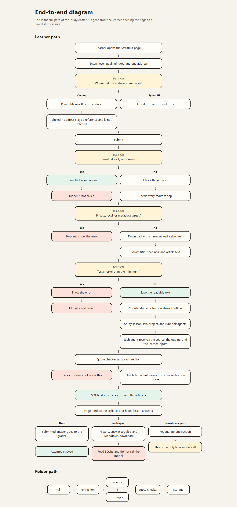
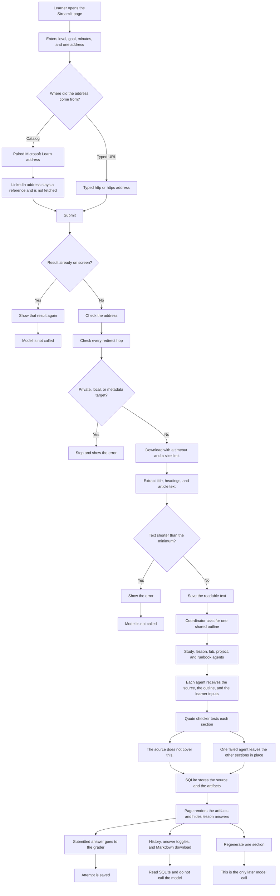
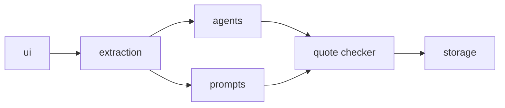

# End-to-end diagram

The picture is [end-to-end-diagram.png](end-to-end-diagram.png). Click that file to see the drawing.

This Markdown file is the written copy of the same path. The short flowchart in [01-studymaster-agent.md](01-studymaster-agent.md) is a summary.

## Learner path

Plain text of the same path:

1. The learner opens the Streamlit page.
2. The learner enters a level, a goal, minutes, and one address.
   - A catalog choice uses the paired Microsoft Learn address.
   - The LinkedIn address stays a reference and is not fetched.
   - A typed address must be `http` or `https`.
3. Submit checks session state.
   - A result already on screen is shown again.
   - The model is not called.
4. A new address is checked, then every redirect hop is checked.
   - A private, local, or metadata target stops the run and shows the error.
5. The reader downloads the page with a timeout and a size limit.
6. The reader extracts the title, headings, and article text.
   - Text shorter than the minimum stops the run and shows the error.
   - The model is not called.
7. Readable text is saved.
8. The coordinator asks for one shared outline.
9. The study, lesson, lab, project, and runbook agents run.
   - Each agent receives the source, the outline, and the learner inputs.
10. The quote checker tests each section.
    - The source does not cover this.
    - One failed agent leaves the other sections in place.
11. SQLite stores the source and the artifacts.
12. The page renders the artifacts and hides lesson answers.
13. A submitted answer goes to the grader, and the attempt is saved.
14. History, answer toggles, and Markdown download read SQLite.
    - The model is not called.
15. Regenerating one section is the only later model call.

## Folder path

Plain text of the same path:

1. `ui` collects the address and the learner inputs.
2. `extraction` checks the address and returns article text, or an error and no text.
3. `agents` runs the coordinator, the outline, the five study agents, and the grader.
4. `prompts` holds the instructions those agents send.
5. The quote checker tests the writing against the extracted text.
6. `storage` saves the source, the artifacts, and the quiz attempts.
